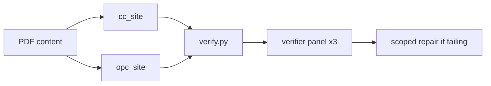

# Graph spec — Core Connections rewrite + Ottawa Pessary Clinic view

## Scope
- In bounds: root *.html, css/, js/, new pessary/ folder, new css/pessary.css, pessary/ assets (SVG logo).
- Out of bounds: images/ (reuse only), PDF, other folders, git commits. Autonomy: edit yes · commit no · destructive no.
- Rounds max 3.

## Nodes
- **cc_site** (worker) — rewrite Core Connections site from the PDF (Fraunces/Inter indigo+citron system kept & extended); add prominent "Go to Ottawa Pessary Clinic" gate in hero + persistent top ribbon on every page. writes: root *.html, css/style.css, js/main.js, sitemap.xml
- **opc_site** (worker) — build pessary/index.html + pessary/visit.html with self-contained css/pessary.css, own JS, own SVG logo (navy + softened complementary palette, per Heather's notes). Creative: interactive element(s). writes: pessary/**, css/pessary.css. Must not touch other files.
- **verify_det** (deterministic) — .graph-loop/check_site.py + verify.py (c1–c4)
- **verify_panel** (verifier ×3) — c5–c7, independent, cite evidence

## Topology

Contract between nodes: pessary URLs are `pessary/index.html`, `pessary/visit.html`; pessary links back with `../index.html`. File ownership is disjoint so no worktrees needed.
